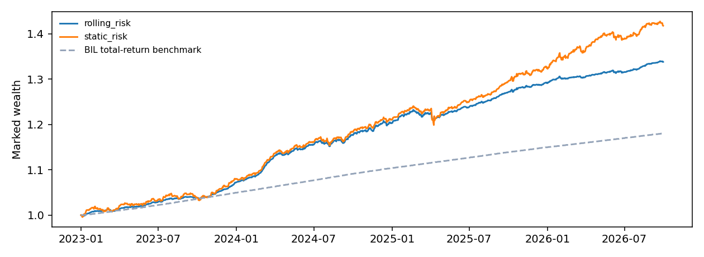

# Regime Lab

**Auditable funding carry, explicit account simulation, and forward paper validation.**

Research by **Panagiotis Baltas** · Python 3.13 reference environment · [MIT license](LICENSE)

How much native BTC/ETH funding carry survives trading costs, collateral, and capital
movement? What changes when it is combined with diversified ETFs? This project
investigates those questions with positions and cash, rather than only combining
return series. The original PCA/HMM work and unsuccessful stock pilot are retained
as research history. **A future Sharpe of two has not been established.**



The chart includes the 2023 replay period. The selected account's 2024 onward daily
evaluation has **1.95 daily / 1.89 monthly / 1.83 HAC-28 excess Sharpe**, 8.39% CAGR,
and −2.28% maximum drawdown. The monthly estimate uses 32 complete calendar months,
January 2024–August 2026; the daily sample ends in September 2026. This history has
already been inspected. See [the evidence and its limits](docs/RESEARCH_NOTE.md).

## Run an offline demonstration

From the repository root in PowerShell:

```powershell
py -3.13 -m venv .venv
.\.venv\Scripts\python.exe -m pip install -r requirements-lock.txt
.\.venv\Scripts\python.exe -m pip install --no-build-isolation --no-deps -e .
.\.venv\Scripts\python.exe -m pip check
.\.venv\Scripts\python.exe -m pytest -q
.\.venv\Scripts\python.exe scripts/reproduce.py demo --output outputs/demo_v1
```

On Linux/macOS use `python3.13` and `.venv/bin/python`. The package supports Python
3.11+, while the pinned dependency set and CI use 3.13. Commands below assume the
environment is activated; otherwise use its Python executable explicitly.

Open `outputs/demo_v1/report.html`. The demo exercises positions, funding, fees,
transfers, and a replayable paper journal. **Its observations are synthetic; its
Sharpe is not trading evidence.** Each workflow needs a new output directory.
Windows/Linux CI runs the tests, demo, gallery build, and wheel build without
market-data downloads. Hosted checks run once the repository is pushed.

## Reproduce the market study

These commands use one consistent directory layout:

```powershell
python scripts/reproduce.py fetch --output outputs/download_v1 --data-root data --end-month 2026-09
python scripts/reproduce.py market --output outputs/market_v1 --data-root data --end-month 2026-09
```

The first command downloads free ETF/cash histories and hourly crypto archives.
It can take substantial time and disk space; availability and revised provider
history can change results. It updates the chosen data cache. Use a separate
`--data-root` to retain an earlier snapshot. Raw downloads stay outside Git and
remain subject to provider terms.

The second runs the exploratory family studies in `outputs/market_v1/study/`, then
the direct account comparison in `outputs/market_v1/execution/`, and saves a
selection audit beside them. It searches the documented candidate families;
repeating an inspected period does not create a new holdout. Use an input cache
ending at the chosen research month: the family studies consume the whole cache,
while the direct replay also applies the requested date bound.

Add `--dry-run` to inspect exact commands without writing or downloading. Each run
stores a `workflow.json` receipt. Historical reports include source/input hashes,
metrics, orders, holdings, decisions, event ledgers, PnL attribution, and independent
reconciliation. Ending NAV marks open positions; it is not guaranteed liquidation
proceeds. [Detailed reproduction and publication instructions](docs/REPRODUCIBILITY.md)
explain the output tree and frozen paper setup.

## What is implemented

- Native coin wallets, whole inverse contracts, reciprocal PnL, and signed funding.
- ETF holding drift, cash, costs, and past-only allocation features.
- Venue/broker cash, idle transfers, and subsequent eligible fills.
- Event-level PnL attribution and independently calculated trade reconciliation.
- Reports following the saved validation selector, with controls and failures kept.
- Source/library-pinned paper models, pre-outcome plans, public snapshots,
  quote-age checks, linked journal records, and independent account-state replay.

The direct variant implements passive carry plus a long-only ETF strategy. A new
HMM/PCA overlay is a subsequent experiment; the original HMM research is preserved.

## Forward paper record

After freezing and planning a model using the [paper runbook](docs/PAPER_RUNBOOK.md),
capture and record in the same process:

```powershell
python scripts/paper_tick.py --model paper/v1 --captures data/captures
python -m regime_lab paper-verify --model paper/v1
```

Each successful tick retains the public snapshot and a separate checkpoint. It
always includes ETF capture, serializes overlapping ticks, and stops on errors.
Keep the checkpoint away from the journal and supply its head with
`--expected-head` on the next tick. Plans wait at least an hour before eligible
trading; transfers take two business days. Stale ETF quotes prohibit ETF fills.

There are no live broker orders or installed background jobs. Planning and frozen
reference refresh remain explicit operations. The curated checkpoint from
20 October 2026 contains one real observation, zero fills, and no forward Sharpe.
It is a dated snapshot, not a live status feed. Operations scripts sit outside the
source-pinned strategy package, preserving the existing paper-v2 model identity.

## Read, demonstrate, or contribute

- [Curated reports and artifacts](examples/README.md).
- [Research note](docs/RESEARCH_NOTE.md): economics, equations, selection, and limitations.
- [Protocol](docs/PROJECT_PROTOCOL.md) and [next experiments](docs/ROADMAP.md).
- [Paper runbook](docs/PAPER_RUNBOOK.md): operation, failure recovery, and checkpoints.
- [Interview guide](docs/INTERVIEW_GUIDE.md): demonstration and technical questions.
- [Research log](RESEARCH_LOG.md) and [earlier research](LEGACY_RESEARCH.md).
- [Contributing](CONTRIBUTING.md): reproducibility and research standards.

Build a local static report gallery with
`python scripts/build_site.py --output outputs/site_v1` and open its `index.html`.
An optional, manually triggered GitHub Pages workflow publishes only curated
artifacts. Setup is documented in the reproduction guide; no public site is
claimed before deployment.

Remaining limits include asynchronous marks, adjusted-price ETF proxies, indicative
quotes without depth, exchange/custody/default risk, simplified settlement calendars
and maintenance rules. Paper splits and dividend receivables are supported; verified
payment-date settlement and broker reconciliation remain future work.

## License and credit

Copyright © 2026 **Panagiotis Baltas**. You may use, modify, and distribute the code,
including commercially, under [MIT](LICENSE). Retain the copyright and license
notice in copies or substantial portions. Dependencies and provider data retain
their own terms.

Please also credit this project in research, public projects, and presentations:

> Baltas, Panagiotis (2026). *Regime Lab: Auditable carry execution and forward paper validation*. Version 0.2.1.

[CITATION.cff](CITATION.cff) enables GitHub's citation feature. The citation request
is a courtesy; MIT's binding attribution requirement is retaining its notices.
